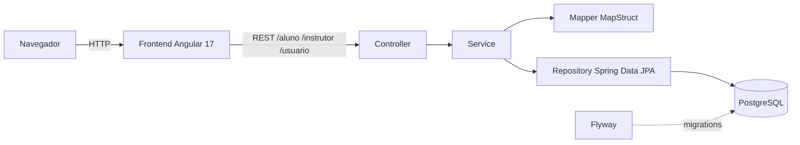
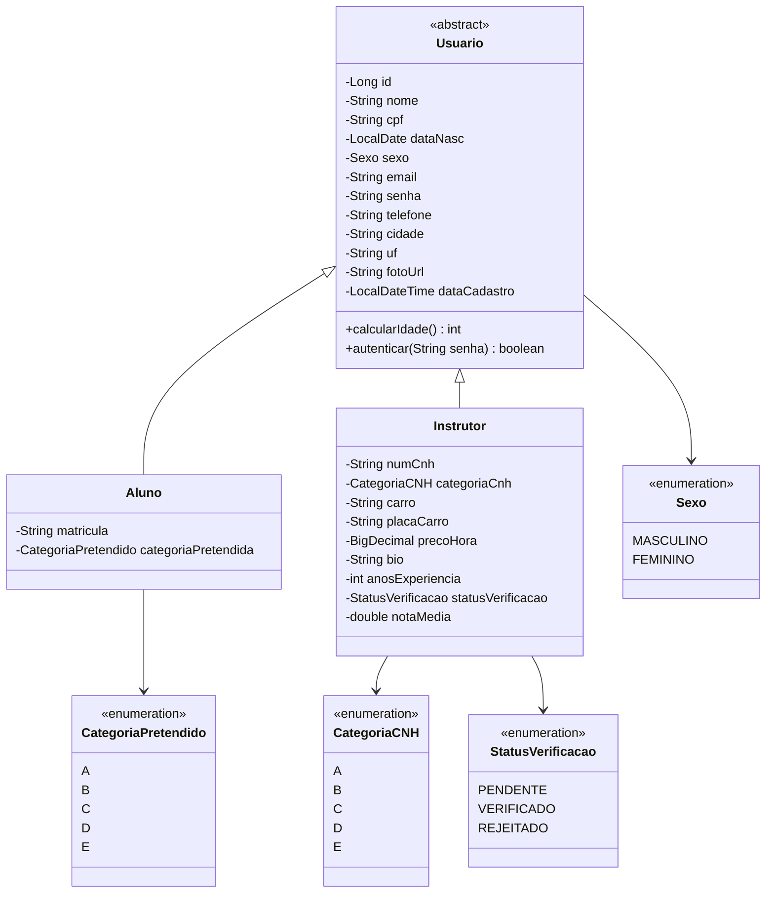

# Connect Drive

Plataforma de intermediação digital entre **instrutores autônomos de direção** e **candidatos à CNH**.

O projeto nasce da flexibilização da obrigatoriedade das autoescolas no Brasil: instrutores devidamente licenciados passam a poder dar aulas de forma independente, mas não existe um canal confiável e especializado para que alunos os encontrem. Hoje a busca acontece por redes sociais e indicações informais, sem verificação profissional nem transparência de preço e qualificação. O Connect Drive propõe um ponto único para cadastro, busca, contato e avaliação.

Projeto desenvolvido por estudantes do **UniCEUB**.

## Sumário

- [Estado do projeto](#estado-do-projeto)
- [Equipe](#equipe)
- [Funcionalidades](#funcionalidades)
- [Requisitos](#requisitos)
- [Arquitetura](#arquitetura)
- [Diagrama de classes](#diagrama-de-classes)
- [Modelo de dados](#modelo-de-dados)
- [API REST](#api-rest)
- [Como executar](#como-executar)
- [Testes](#testes)
- [CI/CD](#cicd)
- [Estrutura do repositório](#estrutura-do-repositório)
- [Documentação adicional](#documentação-adicional)
- [Limitações conhecidas](#limitações-conhecidas)
- [Próximos passos](#próximos-passos)

## Estado do projeto

O projeto está em **desenvolvimento**. A fase de análise e modelagem (Documento de Visão, casos de uso, protótipo) está concluída, e a implementação cobre hoje o **cadastro e a consulta de alunos e instrutores**, com banco versionado por migrations e ambiente completo em Docker.

Login, solicitação de contato, avaliações e chat ainda **não foram implementados**. A seção [Funcionalidades](#funcionalidades) mostra o status de cada caso de uso.

## Equipe

| Integrante |
|---|
| Daniel Alves Dias Fernandes |
| João Guilherme Souza |
| Miguel Ferreira |
| Gabriel Foletto Lorenzi |

## Funcionalidades

O escopo funcional foi definido em nove casos de uso, organizados em três módulos.

Legenda: ✅ implementado · 🟡 parcial · ⬜ não implementado

### Módulo Aluno

| Caso de uso | Descrição | Status |
|---|---|---|
| UC01 | Gerenciar o próprio perfil (cadastrar, consultar, alterar, excluir) | 🟡 Cadastro, consulta e exclusão existem. Alteração não. |
| UC02 | Buscar instrutores por filtros (nome, cidade, carro, categoria, sexo) | 🟡 A API expõe busca por CNH, sexo e nota. Os demais filtros existem só no repositório. |
| UC03 | Solicitar contato com instrutor (pendentes, aceitas, rejeitadas) | ⬜ |
| UC04 | Avaliar instrutor com nota de 1 a 5 (inserir, alterar, excluir, consultar) | ⬜ |

### Módulo Instrutor

| Caso de uso | Descrição | Status |
|---|---|---|
| UC05 | Gerenciar o perfil profissional (cadastrar, consultar, alterar, excluir) | 🟡 Cadastro e consulta existem. Falta upload de documentos, validação e alteração. |
| UC06 | Gerenciar solicitações recebidas (aprovar, rejeitar, consultar) | ⬜ |
| UC07 | Gerenciar a base de alunos vinculados | ⬜ |

### Módulo Geral

| Caso de uso | Descrição | Status |
|---|---|---|
| UC08 | Login por CPF e senha | ⬜ |
| UC09 | Chat entre aluno e instrutor, liberado só após a solicitação ser aprovada | ⬜ |

### Fora do escopo (decisão do projeto)

- Pagamento nativo: o acerto financeiro é feito diretamente entre aluno e instrutor.
- Funcionamento offline.
- Envio de vídeo e negociação de valores pelo chat.
- Versão mobile: a primeira versão é voltada para desktop.

## Requisitos

### Requisitos funcionais

Os requisitos funcionais correspondem aos casos de uso da seção anterior. As regras de negócio principais são:

- **RF01.** O aluno e o instrutor se cadastram informando nome, CPF, data de nascimento, sexo, e-mail, senha, telefone, cidade e UF.
- **RF02.** O sistema gera a matrícula do aluno automaticamente (11 caracteres hexadecimais).
- **RF03.** O instrutor informa número da CNH, categoria, carro, placa, preço por hora, anos de experiência e, opcionalmente, uma bio.
- **RF04.** O instrutor é cadastrado com status de verificação `PENDENTE` e nota média `0`. O perfil só deve ser ativado após a validação documental junto ao DETRAN.
- **RF05.** CPF, e-mail, matrícula e número da CNH são únicos.
- **RF06.** O aluno busca instrutores por nome, cidade, carro, categoria e sexo.
- **RF07.** O chat só é habilitado quando o instrutor aprova a solicitação de contato.
- **RF08.** As avaliações usam a escala de 1 a 5 estrelas.

### Requisitos não funcionais

| Requisito | Meta definida | Situação |
|---|---|---|
| Arquitetura em camadas (MVC) | Separação entre apresentação, lógica de negócio e dados | ✅ Controller, Service, Repository, mais o frontend Angular |
| Banco de dados | Relacional, com integridade referencial | ✅ PostgreSQL com migrations Flyway |
| Latência de busca | Menor que 300 ms | Não medida |
| Latência de cadastro e edição | Menor que 1 s sob carga | Não medida |
| Disponibilidade | 99,5% em horário comercial, com backup diário | Não aplicável ainda |
| Cobertura de testes unitários | 70% | Não medida |
| Acessibilidade | WCAG 2.1 AA | Não avaliada |
| Armazenamento seguro de senha | Criptografia da senha | ⬜ Hoje a senha é gravada em texto puro |
| Autenticação | OAuth2 | ⬜ |
| Trilha de auditoria | Logs de auditoria imutáveis | ⬜ |
| LGPD | Retificação, eliminação e controle de acesso a dados pessoais | 🟡 Existe exclusão de usuário. O restante depende de autenticação. |

## Arquitetura

O backend segue a arquitetura em camadas do Spring, e o frontend é uma SPA Angular servida pelo próprio Spring Boot.



| Camada | Responsabilidade |
|---|---|
| `Controller` | Recebe as requisições HTTP e converte JSON em DTO |
| `Services` | Regras de negócio, como a geração da matrícula |
| `mapper` | Conversão entre DTO e entidade (MapStruct) |
| `repository` | Acesso a dados com Spring Data JPA |
| `entities` | Mapeamento JPA com herança `JOINED` |
| `dto` | Objetos de entrada (`req`) e saída (`resp`), implementados como `record` |

### Tecnologias

| Área | Tecnologia |
|---|---|
| Linguagem | Java 17 |
| Framework | Spring Boot 4.1.1 (Web MVC, Data JPA) |
| Mapeamento | MapStruct 1.6.3 e Lombok |
| Banco de dados | PostgreSQL 18 (Docker). H2 em memória para desenvolvimento local. |
| Migrations | Flyway |
| Frontend | Angular 17 (standalone components, Reactive Forms) |
| Build | Maven (wrapper incluso), empacotamento `war` |
| Testes | JUnit 5, Mockito e MockMvc |
| Infra | Docker e Docker Compose, pgAdmin |
| CI | GitHub Actions |

## Diagrama de classes

Modelo atual das entidades, conforme o código. `Usuario` é abstrata e usa herança `JOINED`: os dados comuns ficam em `usuarios`, e os específicos em `alunos` e `instrutores`.



As classes **Solicitação de Contato**, **Avaliação**, **Chat** e **Mensagem**, previstas na modelagem, ainda não existem no código.

## Modelo de dados

Criado pela migration `V1__schema_inicial.sql`. O Hibernate roda com `ddl-auto=validate`, então o schema só muda por novas migrations.

| Tabela | Chave | Colunas principais |
|---|---|---|
| `usuarios` | `id` (identity) | nome, cpf (único), data_nascimento, sexo, email (único), senha, telefone, cidade, uf, foto_url, data_cadastro |
| `alunos` | `usuario_id` (FK `usuarios`) | matricula (única), categoria_pretendida |
| `instrutores` | `usuario_id` (FK `usuarios`) | numero_cnh (único), categoria_cnh, carro, placa_carro, preco_hora, bio, anos_experiencia, status_verificacao, nota_media |

## API REST

| Método | Rota | Descrição | Resposta de sucesso |
|---|---|---|---|
| `POST` | `/aluno` | Cadastra um aluno | `204` |
| `GET` | `/aluno/matricula/{matricula}` | Busca aluno pela matrícula | `202` |
| `GET` | `/aluno/categoria/{categoria}` | Lista alunos por categoria pretendida | `202` |
| `POST` | `/instrutor` | Cadastra um instrutor | `200` |
| `GET` | `/instrutor/cnh/{cnh}` | Busca instrutor pelo número da CNH | `200` |
| `GET` | `/instrutor/sexo/{sexo}` | Lista instrutores por sexo | `200` |
| `GET` | `/instrutor/nota/{nota}` | Lista instrutores por nota média | `200` |
| `GET` | `/usuario/{id}` | Busca usuário por ID | `202` |
| `GET` | `/usuario/CPF/{cpf}` | Busca usuário por CPF | `202` |
| `GET` | `/usuario/Email/{email}` | Busca usuário por e-mail | `202` |
| `DELETE` | `/usuario/{id}` | Exclui um usuário | `204` |

Exemplo de cadastro de aluno:

```bash
curl -X POST http://localhost:8080/aluno \
  -H "Content-Type: application/json" \
  -d '{
    "nome": "Maria Silva",
    "cpf": "52998224725",
    "dataNasc": "2000-01-15",
    "sexo": "FEMININO",
    "email": "maria@example.com",
    "senha": "SenhaTeste123!",
    "telefone": "61999990000",
    "cidade": "Brasilia",
    "uf": "DF",
    "fotoUrl": null,
    "categoriaPretendida": "B"
  }'
```

Os cenários de teste da API estão descritos em [TESTE.md](TESTE.md).

## Como executar

### Pré-requisitos

- Docker e Docker Compose, para o ambiente completo.
- JDK 17 ou superior, para rodar sem Docker.
- Node.js e npm, para o frontend em modo de desenvolvimento.

### Com Docker (recomendado)

Na raiz do repositório:

```bash
docker compose up -d --build
```

| Serviço | Endereço | Observações |
|---|---|---|
| Aplicação (API e frontend) | http://localhost:8080 | |
| PostgreSQL | `localhost:5433` | Banco `connectdrive`, usuário `connectdrive`, senha `connectdrive` |
| pgAdmin | http://localhost:5050 | Login `connectdrive@connectdrive.com`, senha `connectdrive`. O servidor "Connect Drive" já vem configurado. Na primeira conexão, informe a senha do banco. |

Para parar:

```bash
docker compose down        # mantém os dados
docker compose down -v     # apaga também os volumes do banco e do pgAdmin
```

As credenciais acima servem apenas para uso local.

### Sem Docker (H2 em memória)

```bash
cd connect
./mvnw spring-boot:run        # no Windows: .\mvnw.cmd spring-boot:run
```

Sem variáveis de ambiente, a aplicação usa H2 em memória. O console do H2 fica em http://localhost:8080/h2-console, com URL `jdbc:h2:mem:connectdrive` e usuário `sa`.

### Frontend em modo de desenvolvimento

```bash
cd connect/src/main/webapp/WEB-INF/app
npm install
npm start
```

O Angular sobe em http://localhost:4200 e encaminha as chamadas `/aluno`, `/instrutor` e `/usuario` para `localhost:8080` (arquivo `proxy.conf.json`). A API precisa estar rodando.

### Variáveis de ambiente

| Variável | Padrão | Descrição |
|---|---|---|
| `SPRING_DATASOURCE_URL` | `jdbc:h2:mem:connectdrive` | URL JDBC |
| `SPRING_DATASOURCE_USERNAME` | `sa` | Usuário do banco |
| `SPRING_DATASOURCE_PASSWORD` | `123456` | Senha do banco |
| `SPRING_JPA_HIBERNATE_DDL_AUTO` | `validate` | Modo do Hibernate |
| `SPRING_JPA_SHOW_SQL` | `true` | Exibe o SQL no log |
| `SPRING_H2_CONSOLE_ENABLED` | `true` | Habilita o console do H2 |

## Testes

```bash
cd connect
./mvnw test
```

| Classe | O que cobre |
|---|---|
| `AlunoServiceTest` | Cadastro de aluno, geração de matrícula e falhas de mapeamento e persistência |
| `InstrutorServiceTest` | Cadastro de instrutor e tratamento de falhas |
| `CadastroUsuarioControllerTest` | Recebimento dos dados no controller |
| `ConnectApplicationTests` | Carregamento do contexto Spring |

## CI/CD

O workflow `.github/workflows/ci.yml` roda em pull requests para `main` e `development`, e em pushes na `development`. Ele compila o projeto, executa os testes, gera e publica a imagem Docker e, em caso de falha em PR, comenta o final do log no próprio PR.

Fluxo de trabalho do time: cada funcionalidade nasce em uma branch própria, a partir da `development`, e entra por pull request.

## Estrutura do repositório

```
Connect-Drive/
├── connect/                          Aplicação Spring Boot
│   ├── pom.xml
│   └── src/
│       ├── main/
│       │   ├── java/br/com/connectdrive/
│       │   │   ├── Controller/       Endpoints REST e rota do frontend
│       │   │   ├── Services/         Regras de negócio
│       │   │   ├── repository/       Acesso a dados
│       │   │   ├── mapper/           DTO <-> entidade
│       │   │   ├── entities/         Usuario, Aluno, Instrutor
│       │   │   ├── dto/              req e resp
│       │   │   ├── enums/
│       │   │   └── exceptions/
│       │   ├── resources/
│       │   │   ├── db/migration/     Migrations Flyway
│       │   │   └── static/           Build do frontend servido pelo Spring
│       │   └── webapp/WEB-INF/app/   Código-fonte Angular
│       └── test/                     Testes automatizados
├── pgadmin/servers.json              Servidor pré-configurado do pgAdmin
├── Dockerfile
├── docker-compose.yml
├── Fluxo.md                          Fluxos de criação de aluno e instrutor
├── TESTE.md                          Cenários de teste da API
└── DIAGRAMA.md                       Diagrama de classes da modelagem
```

## Documentação adicional

- [Fluxo.md](Fluxo.md): fluxos principal e alternativos do cadastro de aluno e de instrutor.
- [TESTE.md](TESTE.md): cenários de teste da API, com entradas e respostas esperadas.
- [DIAGRAMA.md](DIAGRAMA.md): diagrama de classes elaborado na fase de modelagem.

## Limitações conhecidas

- Não há autenticação nem autorização: todas as rotas são públicas.
- A senha é gravada em texto puro.
- Não há validação de entrada (formato de CPF, e-mail, UF, placa, preço, idade). Campo ausente ou CPF e e-mail duplicados só aparecem como erro ao gravar no banco.
- O tratamento global de exceções foi removido, então os erros seguem o comportamento padrão do Spring.
- O cadastro de instrutor não recebe documentos, e o status `PENDENTE` ainda não tem fluxo de verificação.
- Os códigos HTTP não são uniformes (`204` no cadastro de aluno, `200` no de instrutor, `202` em consultas).
- O formulário do frontend oferece a opção de sexo "Outro", que o backend ainda não aceita.

## Próximos passos

1. Validação de entrada (Bean Validation) e resposta `409` para CPF e e-mail duplicados.
2. Autenticação com hash de senha e login (UC08).
3. Fluxo de verificação do instrutor e upload de documentos.
4. Busca de instrutores por todos os filtros previstos (UC02).
5. Solicitação de contato e sua aprovação (UC03 e UC06).
6. Avaliações (UC04), alimentando a nota média do instrutor.
7. Chat entre aluno e instrutor (UC09).
8. Testes de integração com banco real.
